  

Hi, I'm Kaan 👋 · from Istanbul, Turkey · based in Eindhoven, NL

  
  

I build software end to end, from the model to the pixels. CSE student at TU/e in Eindhoven, originally from Istanbul.

## Stack

## Follow the build

I post progress on X: [@kaankuzudev](https://x.com/kaankuzudev)

More about me: [kaankuzu1.github.io](https://kaankuzu1.github.io)
