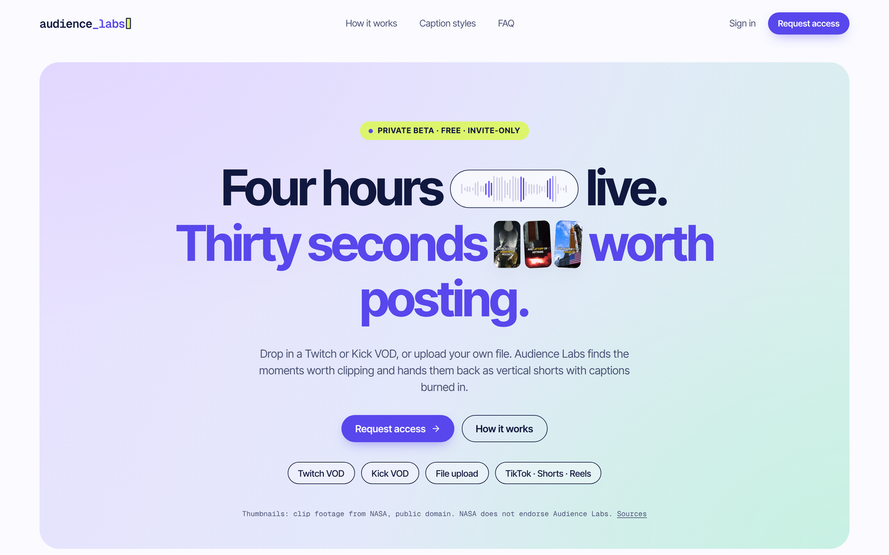

<p align="center">
  
</p>

<p align="center">Hi, I'm Kaan 👋 · from Istanbul, Turkey · based in Eindhoven, NL</p>

<p align="center">
  <a href="https://www.linkedin.com/in/kaankkuzu"></a>
  <a href="mailto:kaankuzu122@outlook.com"></a>
</p>

I build AI products end to end, from the model to the pixels. CSE student at TU/e in Eindhoven, originally from Istanbul.

## Right now: [Audience Labs](https://audiencelabs.net)

Streamers sit on hours of VODs nobody rewatches. Audience Labs takes a Twitch or Kick VOD, transcribes it with Whisper, works out who is speaking and when the energy spikes, has an LLM pick the moments worth posting, scores them, and renders vertical clips with animated captions for TikTok, Shorts and Reels.

<a href="https://audiencelabs.net"></a>

It's in private beta. **[Request access →](https://audiencelabs.net/request-access)**

## Open source

**[clip-virality-scorer](https://github.com/kaankuzu1/clip-virality-scorer)** is the part of Audience Labs that decides which clips are worth posting, pulled out into a small Python package you can use on your own clips.

```bash
pip install "git+https://github.com/kaankuzu1/clip-virality-scorer"
clip-scorer rank hooks.json
```

## Stack


## Follow the build

I post progress on X: [@kaankuzudev](https://x.com/kaankuzudev)

More about me: [kaankuzu1.github.io](https://kaankuzu1.github.io)
