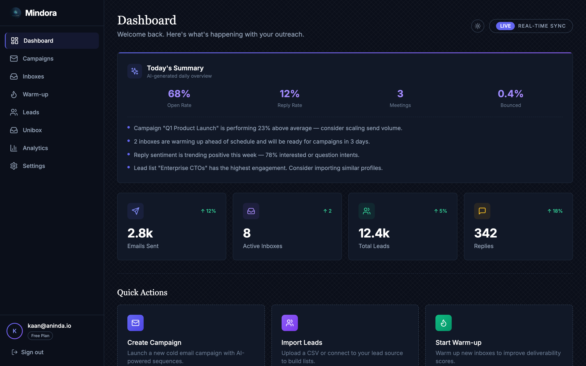

# Hi, I'm Kaan

BSc Computer Science and Engineering student at [Eindhoven University of Technology (TU/e)](https://www.tue.nl/en/), originally from Istanbul. I like taking a product from idea to something people can actually use: frontend, backend, infra, ML and the boring glue in between.

## What I'm building

### [Audience Labs](https://audiencelabs.net)

Clip automation for streamers. You paste a Twitch or Kick VOD link (or upload a file), the pipeline transcribes it with Whisper on GPU, adds speaker diarization and audio-emotion signals, and an LLM finds the moments worth posting. Each hook gets a virality score plus Hook / Flow / Value / Trend grades, then the app renders vertical clips with word-level animated captions and an optional on-screen hook, ready to review and schedule for TikTok, YouTube Shorts and Instagram Reels.

Next.js 16 dashboard, Python worker (yt-dlp, FFmpeg, faster-whisper, pyannote), Supabase for data and realtime, Cloudflare R2 for storage, Modal for GPU jobs. The app code is private; the [landing page](https://github.com/kaankuzu1/growthlanding) is public.

**Private beta is open:** [request access at audiencelabs.net](https://audiencelabs.net/request-access)

### Yolofootball

Computer vision for 1v1 football. Point a camera at a side-angle clip and get back a timestamped JSON timeline of tackles, tricks, passes, shots and goals. YOLO detects the players, ball and goal, a tracker follows them, and two rule engines turn the tracks into events, with a macOS app for recording and reviewing. Source: [Yolofootball](https://github.com/kaankuzu1/Yolofootball)

### Aninda

Cold email platform for agencies: multi-inbox campaigns with A/B variants, automated warmup, lead verification and reply intent detection. NestJS API, Next.js dashboard, BullMQ workers, Supabase. Source: [Anindav2](https://github.com/kaankuzu1/Anindav2)

## Other projects

- [IntenseRPG11](https://github.com/kaankuzu1/IntenseRPG11): on-chain RPG items in Sui Move, written while learning the language
- [ProjectCalculator](https://github.com/kaankuzu1/ProjectCalculator): one of my first projects, a plain HTML/CSS/JS calculator ([live](https://kaankuzu1.github.io/ProjectCalculator/))

## Tools I use most

